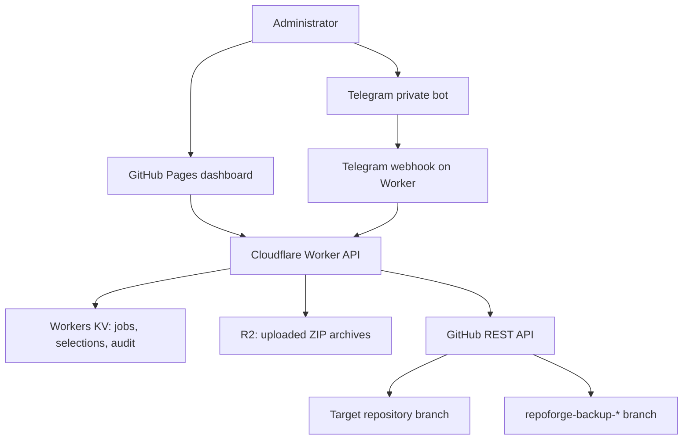

# RepoForge architecture

## High-level flow

## Upload and preview

1. The user selects an allowlisted repository and branch, then uploads a ZIP.
2. The Worker validates archive structure before extraction: entry count, total expanded bytes, per-file size, encryption, compression method, ZIP64, symlinks, duplicate names and unsafe paths.
3. A common top-level directory can optionally be stripped. The dashboard exposes this as a checkbox; Telegram defaults it on.
4. The Worker downloads the target branch HEAD and recursive Git tree.
5. A preview is built from the union of ZIP paths and repository paths:
   - ZIP-only or matching ZIP paths default to `update`.
   - Repository-only paths default to `keep`.
6. The archive is retained in R2; job metadata and path choices are stored in KV.

## Deployment

1. The Worker reloads the job and confirms it is pending.
2. The current branch SHA is compared with the preview's base SHA. A mismatch marks the job stale.
3. Every selected path is validated against the preview manifest. The changed-file cap is checked before GitHub mutations.
4. The job status is marked `deploying`.
5. A backup branch is created at the current HEAD.
6. Selected ZIP files are uploaded as Git blobs. Deletions are represented as `sha: null` tree entries.
7. A new Git tree is created using the current tree as `base_tree`.
8. A single commit is created with the current HEAD as its parent.
9. The target branch ref is updated with `force: false`.
10. Job state and an audit event are recorded.

If the branch moves while the deployment is running, the non-force ref update fails safely. The backup ref remains available. No automatic force-push is attempted.

## Restore

Restore creates a backup of the current target branch first. It fetches the selected backup commit's tree, creates a new commit using that tree and the current HEAD as parent, and advances the branch ref without force. This restores tracked file content while preserving the chronological commit history.

## Authentication

### Dashboard

- User enters one password.
- Worker validates the password, applies a KV-backed attempt limit, then signs an HMAC session token.
- Frontend stores the short-lived token in `sessionStorage` and sends it as a Bearer token.
- Every dashboard API route checks both the signature/expiry and the exact configured `Origin`.
- The token is not a GitHub credential and cannot be used against GitHub directly.

### Telegram

- Webhook validates `X-Telegram-Bot-Api-Secret-Token`.
- Each message and callback must originate from the configured numeric admin ID in a private chat.
- Deploy and restore require a separate inline confirmation callback.

## Storage

| Store | Keys / objects | Retention |
|---|---|---|
| KV | `job:<id>` | 14 days |
| KV | `backup:<repo>:<id>` | No TTL by default |
| KV | `event:<timestamp>:<id>` | 180 days |
| KV | `tg-selection:<admin-id>` | No TTL by default |
| R2 | `uploads/<job-id>.zip` | Configure 14-day bucket lifecycle |

Backup refs live in GitHub. Do not delete `repoforge-backup-*` branches until you no longer need those restore points.
